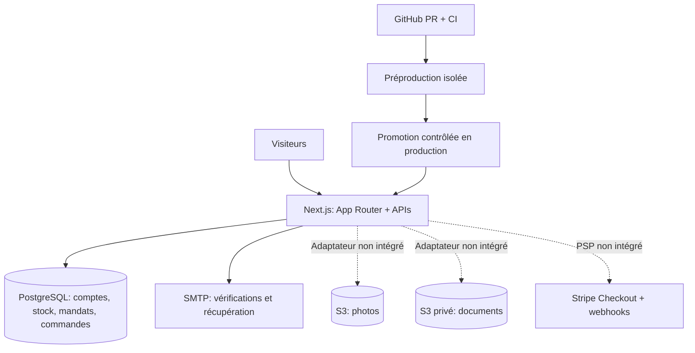

# Renn’Fripes — architecture technique

## Situation actuelle

Application **Next.js 16 / React 19 / TypeScript** sous Node.js, organisée en monolithe modulaire. Les Route Handlers `app/api/` assurent l'API serveur ; les composants React rendent les parcours client et administrateur. L'application n'est **pas un export statique**.

La plateforme est en **préparation commerciale**, pas en production de paiement.

## Schéma logique

## Répartition des responsabilités

| Répertoire | Responsabilité |
| --- | --- |
| `app/` | Pages Next.js, API publiques/privées, contrôles de permission en bordure |
| `components/` | Interface React, sans secrets de serveur |
| `lib/config/env.ts` | Source unique de configuration serveur, feature flags et validation |
| `lib/security.ts` | Sessions, mots de passe, origine des écritures, limites de requête |
| `lib/db.ts` | Pool PostgreSQL partagé et API d'accès SQL |
| `lib/mail.ts` | Notifications SMTP de compte |
| `modules/catalog/` | Catalogue de démonstration JSON et articles réels PostgreSQL |
| `modules/consignment/` | Calculs et règles de dépôt-vente |
| `modules/orders/` | Calculs de commandes, sans paiement réel |
| `infra/sql/` | Schéma SQL ordonné `001` à `007` |
| `scripts/` | Diagnostics, migrations de test et smoke tests |
| `.github/workflows/` | Lint, build, audit de dépendances, tests SQL, sécurité et navigateur |
| `docs/` | Contrats métier, recette, exploitation et suivi des releases |

## Données et sécurité

- **PostgreSQL** conserve les utilisateurs, sessions, autorisations, stocks, mandats et historiques.
- **Mouvements de stock** soumis à des transitions métier et à des contraintes SQL. Les preuves V0.2 enregistrées sont verrouillées contre modification/suppression ordinaires.
- **Authentification** basée sur des mots de passe hachés (scrypt), sessions HTTP-only et tokens à usage unique.
- **S3** : buckets provisionnés sur Railway. Les URLs présignées, contrôles des objets et références persistées restent à développer ; le code actuel peut référencer des images suivies dans `public/` ou des URLs HTTPS d'hôtes explicitement autorisés. Il ne gère pas encore de téléchargements clients durables.
- **Paiement** : aucun encaissement réel. `ORDERS_ENABLED` doit rester `false` en production tant que Checkout, webhooks signés et réservation atomique ne sont pas validés.
- **Mandats** : documents à empreinte SHA-256, pas une signature qualifiée ; validation juridique requise avant lancement.

## Infrastructure Railway

| Usage | Projet existant | Services |
| --- | --- | --- |
| Production | `angelic-transformation` | Next.js, PostgreSQL 18 avec volume ; buckets `rennfripes-media` et `rennfripes-documents` |
| Préproduction | `sparkling-upliftment` | Next.js, PostgreSQL 18 isolé avec volume ; bucket `rennfripes-staging-media` |

**Attention :** le second projet utilise encore un environnement Railway nommé `production` malgré son rôle de test. `RF_DEPLOY_ROLE=staging` permet d'identifier son usage. Les régions de la base et de l'application peuvent différer ; la migration de PostgreSQL vers l'UE doit suivre une sauvegarde et un test de restauration.

## Déploiement

1. Développer dans une branche **non connectée** à Railway production.
2. Vérifier `npm ci`, les tests unitaires, `test:config`, `test:release`, lint, build, et la CI PostgreSQL.
3. Déployer d'abord la préproduction, avec des variables et une base distinctes.
4. Évaluer les changements SQL et la compatibilité avec l'ancienne version.
5. Tester les sauvegardes et les procédures de retour arrière.
6. Promouvoir uniquement après validation de `docs/PRODUCTION-READINESS.md`.

La branche `security/dependency-hardening` est actuellement utilisée par Railway : pousser dessus peut déclencher un déploiement. Les changements de durcissement se font sur une branche de PR indépendante.

## Disponibilité et supervision

- `/api/health/live/` : **liveness**, sans dépendance PostgreSQL (HTTP 200).
- `/api/health/` : **readiness**, HTTP 503 si PostgreSQL ne répond pas.
- Les deux réponses déclarent `Cache-Control: no-store`.
- Des en-têtes HTTP de base bloquent le framing, la détection MIME et le transfert du referrer.
- Les métriques d'exploitation, alertes, SLA et backups réguliers restent à formaliser.
