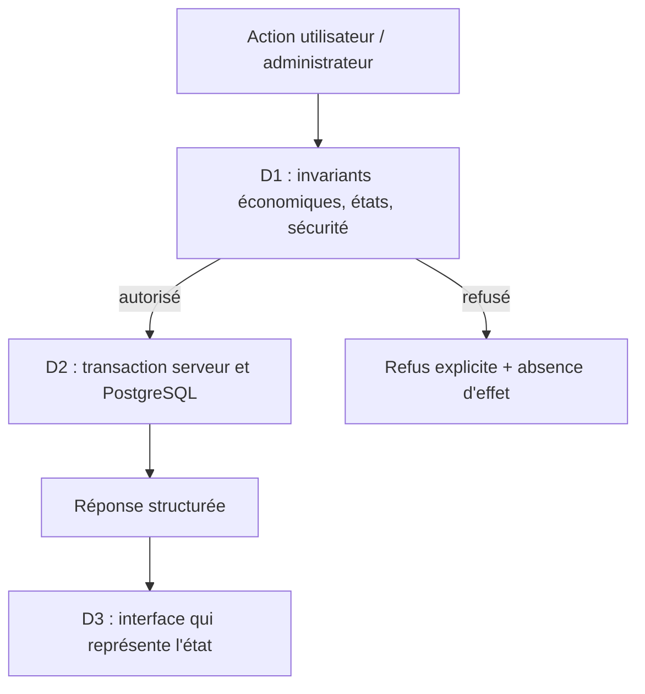
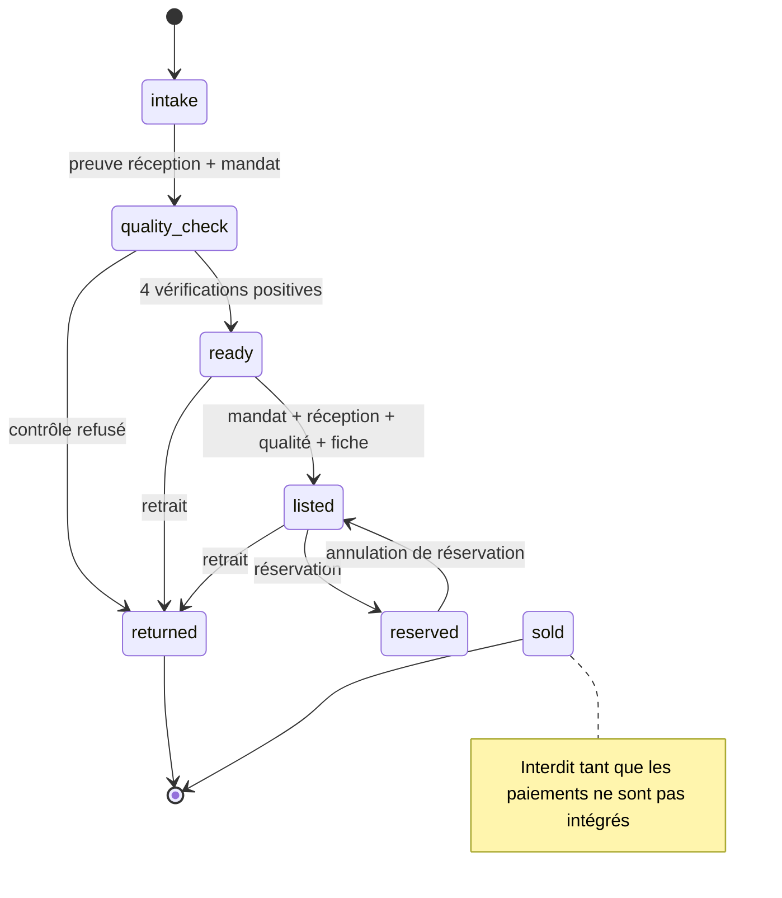

# V0.5.1 — Invariants du domaine (dimension 1)

Statut : **implémentation sur branche de développement**, sans promotion Railway.

## Principe systémique

La dimension 1 n'est pas un écran ou un service externe. Elle fixe les règles
qu'une requête UI, une API ou un script SQL n'a pas le droit de violer.



## Contrats implémentés

| ID | Invariant | Code exécutable | Contrôle |
| --- | --- | --- | --- |
| E1 | Montants non négatifs en centimes entiers, commission en points de base 0–10000 | `modules/consignment/finance.ts` | Cas limites + 12 000 tirages |
| E2 | `prix = commission + reversement déposant` | `calculateConsignment` | Tests de propriétés |
| E3 | Commission exacte : `floor((prix_centimes × bps + 5000) / 10000)`, calcul BigInt | `calculateConsignment` | Oracle BigInt, arrondi et monotonie |
| E4 | `contribution = commission - coûts variables` ; perte possible | `modules/economics/viability.ts` | Propriété de linéarité |
| E5 | `résultat_mensuel = ventes_payées × contribution - charges_fixes` | `calculateViability` | 6 000 scénarios et seuil minimal |
| W1 | Les transitions admin ne peuvent contourner réception/qualité/publication | `modules/inventory/state-machine.ts` + route admin | Graphe complet des états |
| W2 | Catalogue uniquement si état `listed` + réception, qualité positive, mandat et publication | `hasPublicationEvidence`, `canShowInCatalog` + SQL | 4 000 scénarios + test PostgreSQL |
| W3 | Aucun état `sold` sans paiement vérifié, même via SQL direct | `infra/sql/008_v051_unsettled_sale_guard.sql` | Régression PostgreSQL |
| S1 | Origine HTTP de modification strictement égale à `APP_ORIGIN` ; pas de `Host` de confiance | `lib/security/origin-policy.ts` + `trustedRequest` | Cas adversariaux et 3 000 origines |
| S2 | Empreinte SHA-256 reproductible et comparaison contrôlée des preuves | `lib/crypto/evidence.ts` | 1 500 documents et altérations |
| S3 | Archives de preuves non modifiables par opérations SQL courantes | `infra/sql/007_v02_hardening.sql` | Régression PostgreSQL existante |

**Important :** une empreinte SHA-256 seule n'est ni une signature électronique qualifiée,
ni une garantie d'identité, ni une preuve qu'un tiers indépendant a horodaté le document.

## États métier autorisés



Les deux règles de sécurité sont appliquées à des niveaux différents :
1. **Application** : l'API refuse les transitions manuelles non autorisées et valide les preuves.
2. **PostgreSQL** : les triggers 006, 007 et 008 protègent la persistance contre les contournements ordinaires.

Le trigger 008 est **additif et idempotent**. Il est appliqué automatiquement en préproduction
par `scripts/migrate-staging.mjs`, mais **ne doit pas être appliqué à la production sans
sauvegarde et restauration vérifiées**. Une future version de paiement devra remplacer son
interdiction absolue par une confirmation PSP signée et idempotente, de manière atomique.

## Tester

```bash
npm ci
npm run test:invariants
npm run test:unit
npm run test:release
npm run lint
npm run build
```

`test:invariants` utilise un générateur pseudo-aléatoire **à graine fixe**
(`0x5172A11`), avec plus de **30 000 cas déterministes** et des valeurs aux limites.
La sortie d'échec indique la graine et l'indice à reproduire. Il ne s'agit pas d'un
moteur externe comme fast-check et il n'y a pas encore de réduction automatique
des contre-exemples (*shrinking*). Les cas générés complètent, sans remplacer,
les tests d'intégration PostgreSQL.

Les deux workflows GitHub Actions exécutent les tests unitaires, et le workflow
principal exécute les contraintes de stock sur une base de test séparée.

## Limites avant V1.0

- La viabilité est un **modèle d'hypothèses**, pas une prévision de ventes ou une comptabilité.
- Le modèle ne résout pas encore TVA, frais réels de PSP, pertes, taux de retour par cohorte,
  coûts d'acquisition, frais de transport ou obligations réglementaires.
- Le catalogue peut filtrer les produits publiés, mais le contrôle d'un paiement et
  le rapprochement bancaire n'existent pas encore.
- L'authentification, les habilitations, la base et les clés secrètes doivent continuer
  d'être évaluées et testées séparément ; cette suite ne certifie pas la sécurité globale.
