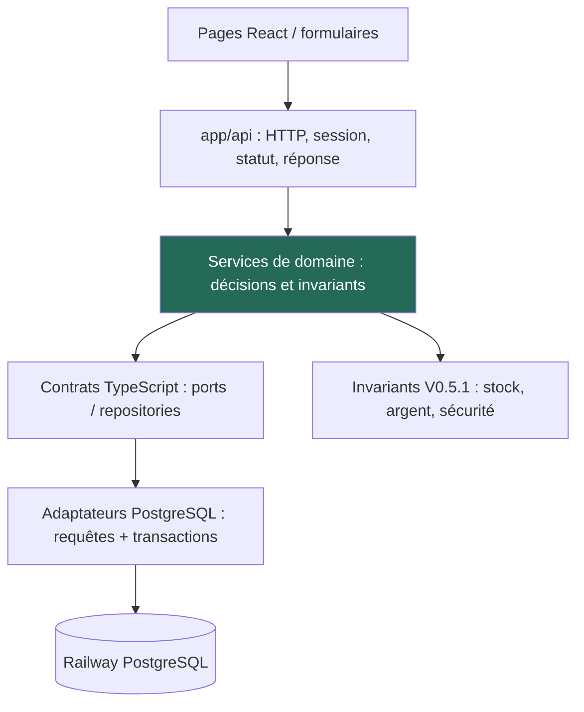

# Renn'Fripes — V0.5.2 : séparation des services métier et contrats

**Statut :** branche de développement / recette, non validée pour le commerce réel.

## Architecture hexagonale légère — sans microservices



Ces couches restent dans le **même déploiement Next.js** et n'impliquent aucun serveur additionnel.

## Contrats implémentés et routes conservées

| Route existante | Contrat d'application | Adaptateur | Enveloppe JSON historique |
| --- | --- | --- | --- |
| `GET /api/consignments/` | `ConsignmentRepository.listForOwner` | `postgresConsignmentRepository` | `{requests}` |
| `POST /api/consignments/` | `createConsignmentService.create` | même adaptateur | 201 `{request}` |
| `PATCH /api/consignments/[id]/` | `createConsignmentService.withdraw` | même adaptateur | `{request}` |
| `GET /api/admin/consignments/` | `listForAdmin` | même adaptateur | `{requests}` |
| `PATCH /api/admin/consignments/[id]/` | `createReviewService.transition` | `postgresReviewUnitOfWork` | `{id,status}` |
| `GET /api/orders/` | `listForBuyer` | `postgresOrderRepository` | `{orders}` |
| `POST /api/orders/` | `createOrderService.request` | même adaptateur | 201 `{order,notice}` (si autorisé) |
| `PATCH /api/orders/[id]/` | `createOrderService.cancel` | même adaptateur | `{order}` |
| `GET /api/admin/orders/` | `listForAdmin` | même adaptateur | `{orders}` |
| `PATCH /api/admin/inventory/[id]/` | `createInventoryService.changeState` | `postgresInventoryUnitOfWork` | `{state}` |

Les codes `401`, `403`, `400`, `404`, `409`, `500` et `503` sont conservés selon les conditions applicables. **Aucune route existante renommée.**

Les endpoints complexes de mandats et des opérations `receive/quality/publish` conservent volontairement pour cette version leurs transactions existantes. Leur extraction doit faire l'objet d'une PR spécifique et de tests fonctionnels renforcés pour éviter une régression des preuves immuables.

## Règles de séparation

- **Routes** : HTTP, cookies, authenticité de l'origine, identité, conversion des résultats métier en codes HTTP.
- **Services** : validation, transitions, décisions, messages métier, orchestration via ports.
- **Contrats** : TypeScript uniquement, aucun secret ni import Next.js/PostgreSQL.
- **Adaptateurs** : SQL PostgreSQL, `FOR UPDATE`, `BEGIN/COMMIT/ROLLBACK`, mapping des lignes.
- **Domaine V0.5.1** : conservation monétaire, sécurité, preuves, politique des transitions.
- **Aucun service ne doit importer `@/lib/db`** ; seules les implémentations `*.pg.ts` y accèdent.

Les services exposent un `DomainResult<T>` :
```ts
type DomainResult<T> =
  | {ok:true;value:T}
  | {ok:false;status:number;error:string};
```
Cette structure n'est **pas envoyée telle quelle** aux utilisateurs : les routes la transforment en réponses JSON identiques aux anciennes.

## Vérification des contrats et de la non-régression

```text
scripts/test-domain-services.mjs   → mocks injectés ; décisions, contrats, transactions
scripts/smoke-contracts.mjs        → vérifie les réponses HTTP sans session sur serveur local
scripts/smoke-v02.mjs              → cycle réel dépôt/mandat/réception/contrôle/publication
scripts/test-v02-db.mjs            → contraintes SQL et preuves
tests/e2e/                       → navigation Playwright
scripts/test-invariants.mjs        → propriétés économiques, de sécurité et d'états
```

GitHub Actions exécute ces contrôles dans une base de test, sans requérir d'action Codespaces.

## Publication Railway

Développement sur la branche isolée `feat/v0.5.2-domain-services`. Le service
Railway de production suit une autre branche et ne doit **pas** être modifié
avant validation du cumul de versions, sauvegardes et approbation des critères
de release. Après CI verte, la préproduction peut pointer vers cette branche
pour une recette automatisée, sans commandes ni paiement réel.

**Aucune migration SQL supplémentaire en V0.5.2** : les contrats et adaptateurs
préservent le schéma PostgreSQL V0.5.1, y compris l'interdiction de vente sans
paiement vérifié.
